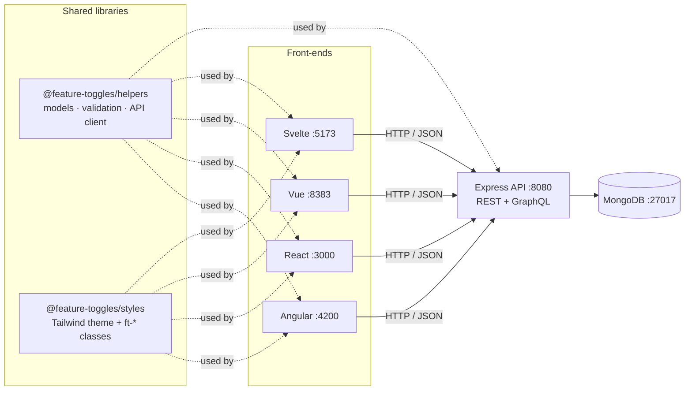

# Feature toggles — one app, many frameworks

A learning monorepo: the **same small app** is built with **Angular, React, Vue and Svelte**, all talking to
**one shared API**. Because the features, markup, styles and validation rules are identical everywhere, the only
thing that changes from one app to the next is _how each framework does it_, which makes them easy to compare
side by side.

The code is commented on purpose, with links to the official documentation for the patterns it uses.

## Contents

- [The app](#the-app)
- [Architecture](#architecture)
- [Getting started](#getting-started)
- [How the monorepo works](#how-the-monorepo-works)
- [The shared libraries](#the-shared-libraries)
- [The API](#the-api)
- [Same app, four ways](#same-app-four-ways)
- [Testing](#testing)
- [Tooling notes](#tooling-notes)
- [Ideas for exercises](#ideas-for-exercises)
- [Troubleshooting](#troubleshooting)

## The app

A [feature toggle](https://martinfowler.com/articles/feature-toggles.html) (or feature flag) is a named setting
that switches behaviour on or off, or tunes it, without deploying new code: `darkMode: true`, `maxItems: 25`,
`welcomeMessage: "Hello!"`.

Every front-end has the same two screens:

- **Features list** (`/features`): one card per toggle, with its key, description and current value.
  The `+` button opens an empty form.
- **Feature form** (`/features/:id`, or `/features/new` to create one): key, description, a **type**
  (Toggle, String or Number) and a **value** whose input depends on that type: a switch, a text box or a number box.
  A live preview shows the JSON the toggle produces, and **Save** stays disabled until the form is valid.

Changing the type converts the current value when it can (`"25"` → `25`), so the value always matches its type.

## Architecture



| Package                        | What it is                                 | Main technologies                                                                  |
| ------------------------------ | ------------------------------------------ | ---------------------------------------------------------------------------------- |
| [`apps/express`](apps/express) | REST + GraphQL API                         | Express 5, Mongoose 9, GraphQL Yoga, graphql-compose-mongoose                      |
| [`apps/angular`](apps/angular) | Front-end                                  | Angular 22: standalone components, zoneless, signals, `httpResource`, Signal Forms |
| [`apps/react`](apps/react)     | Front-end                                  | React 19, React Router 8 (data mode with loaders), Formik, Vite                    |
| [`apps/vue`](apps/vue)         | Front-end                                  | Vue 3.5 with `<script setup>`, Vue Router 5, Vite                                  |
| [`apps/svelte`](apps/svelte)   | Front-end                                  | Svelte 5 (runes), SvelteKit 3 as a single-page app                                 |
| [`libs/helpers`](libs/helpers) | Shared TypeScript: model, validation, HTTP | TypeScript, axios                                                                  |
| [`libs/styles`](libs/styles)   | Shared look & feel                         | Tailwind CSS v4                                                                    |

All four front-ends are **single-page apps** (SPAs): the browser downloads the app once, then the framework's
router swaps screens without reloading the page and fetches data from the API as JSON.

## Getting started

### Requirements

- [Node.js](https://nodejs.org) 24 or newer
- [pnpm](https://pnpm.io) 12. Running `corepack enable` once makes Node use the exact version pinned in
  `package.json` ([Corepack](https://nodejs.org/api/corepack.html)).
- A Docker engine, to run MongoDB locally: [Docker Desktop](https://docs.docker.com/get-docker/), or on macOS the
  lighter [OrbStack](https://orbstack.dev), which provides the same `docker` commands. It must be running before you
  start the app; turning on its "start at login" option saves you from thinking about it.
  Any MongoDB works if you point `DB_URI` at it.

### Run it

```sh
pnpm install                                     # installs every package in the monorepo
cp apps/express/.env.example apps/express/.env   # API settings: DB_URI and PORT
pnpm dev                                         # starts MongoDB, then the API + all four front-ends
```

Then open any of the front-ends. They share the same data, so a toggle saved in one appears in the others:

| App     | URL                   |
| ------- | --------------------- |
| Angular | http://localhost:4200 |
| React   | http://localhost:3000 |
| Vue     | http://localhost:8383 |
| Svelte  | http://localhost:5173 |

To work on one framework at a time, start it together with just the API it needs:

```sh
pnpm dev:angular   # or dev:react, dev:vue, dev:svelte
pnpm dev:api       # API only
```

Every `dev` script first runs `pnpm db:up`, which starts the MongoDB container from
[`compose.yaml`](compose.yaml), or does nothing if it's already running. `pnpm db:down` stops it; the data is kept
in a Docker volume, so it's still there next time.

The local database has **no username or password**: the official `mongo` image only enables authentication when
`MONGO_INITDB_ROOT_USERNAME` and `MONGO_INITDB_ROOT_PASSWORD` are set ([image docs](https://hub.docker.com/_/mongo)).
That's why `compose.yaml` publishes its port on `127.0.0.1` only: it's reachable from your machine, but not from
other devices on your network.

### All scripts

Run them from the repository root:

| Command                                                     | What it does                                                |
| ----------------------------------------------------------- | ----------------------------------------------------------- |
| `pnpm dev`                                                  | Start MongoDB, the API and all the front-ends in watch mode |
| `pnpm dev:angular` / `dev:react` / `dev:vue` / `dev:svelte` | Start MongoDB, one front-end and the API                    |
| `pnpm dev:api`                                              | Start MongoDB and the API only                              |
| `pnpm build`                                                | Production build of every package                           |
| `pnpm test`                                                 | Run every test suite                                        |
| `pnpm lint`                                                 | ESLint                                                      |
| `pnpm typecheck`                                            | Type-check every package (`tsc`, `vue-tsc`, `svelte-check`) |
| `pnpm format` / `pnpm format:check`                         | Format with Prettier / check formatting                     |
| `pnpm db:up` / `pnpm db:down`                               | Start / stop the MongoDB container                          |

## How the monorepo works

A **monorepo** keeps several related packages in one repository, so they can share code and be changed together
in a single commit. Two tools make that work here.

### pnpm workspaces: one install, linked packages

[`pnpm-workspace.yaml`](pnpm-workspace.yaml) declares that every folder in `apps/` and `libs/` is a package.
A single `pnpm install` at the root installs everything, and packages depend on each other with the
[`workspace:` protocol](https://pnpm.io/workspaces#workspace-protocol-workspace):

```jsonc
// apps/react/package.json
"dependencies": { "@feature-toggles/helpers": "workspace:*" }
```

pnpm links `node_modules/@feature-toggles/helpers` to `libs/helpers`, so the apps always use the local code
rather than a published version. [pnpm workspaces docs](https://pnpm.io/workspaces)

### Turborepo: running tasks in the right order

Each package defines the same script names (`dev`, `build`, `test`, `lint`, `typecheck`).
[Turborepo](https://turborepo.com/docs) runs them across all packages, using [`turbo.json`](turbo.json) to know
the order:

```json
"build": { "dependsOn": ["^build"] }
```

`^build` means "first build the packages I depend on". So before React builds, `libs/helpers` is compiled.
Turborepo also **caches** results: if nothing changed in a package, its task is replayed from cache instantly.
[Task dependencies](https://turborepo.com/docs/crafting-your-repository/configuring-tasks) ·
[Caching](https://turborepo.com/docs/crafting-your-repository/caching)

`--filter` limits a run to some packages. That's how the `dev:<app>` scripts in the root
[`package.json`](package.json) start only one front-end:

```sh
turbo run dev --filter=@feature-toggles/react --filter=@feature-toggles/express --filter=@feature-toggles/helpers
```

### Shared configuration

These live at the root and apply to every package:

- [`tsconfig.base.json`](tsconfig.base.json): common TypeScript compiler options, extended by each package's
  `tsconfig.json`. [`extends` docs](https://www.typescriptlang.org/tsconfig/#extends)
- [`eslint.config.js`](eslint.config.js): one ESLint
  [flat config](https://eslint.org/docs/latest/use/configure/configuration-files) for the whole repo, with
  framework-specific rules applied by file path.
- [`.prettierrc.json`](.prettierrc.json): code formatting. ESLint leaves formatting to
  [Prettier](https://prettier.io).

## The shared libraries

### `@feature-toggles/helpers`

Code that would otherwise be duplicated in five places. The API uses it too, so the server and the front-ends agree
on what a valid feature is.

| File                                                      | Contents                                                                                                 |
| --------------------------------------------------------- | -------------------------------------------------------------------------------------------------------- |
| [`models/feature.ts`](libs/helpers/src/models/feature.ts) | The `Feature` type and `FeatureValueType` (`'string' \| 'number' \| 'boolean'`)                          |
| [`form/index.ts`](libs/helpers/src/form/index.ts)         | `validateFeature` (the validation rules), `castFeatureValue`, `normalizeFeature`, `featurePreview`       |
| [`api/`](libs/helpers/src/api)                            | An [axios](https://axios-http.com) client: `FeaturesService.getAll()`, `FeatureService.get/add/update()` |

It's compiled with `tsc` to JavaScript plus type declarations in `dist/`; that's the `build` step Turborepo runs
before the apps. The Angular app uses Angular's own `HttpClient` instead of the axios services, but still shares
the model and validation.

### `@feature-toggles/styles`

[`libs/styles/src/index.css`](libs/styles/src/index.css) is a [Tailwind CSS v4](https://tailwindcss.com/docs)
stylesheet with a small theme and a set of `ft-*` component classes (`ft-card`, `ft-input`, `ft-btn`…).
Each app imports it after Tailwind:

```css
@import 'tailwindcss';
@import '@feature-toggles/styles';
```

So the same HTML looks identical in every framework, while one-off layout uses plain Tailwind utility classes in
the templates. The [switch](libs/styles/src/index.css) is a nice example of Tailwind's `peer-*` variants: a
visually hidden checkbox styles the track next to it.

## The API

[`apps/express`](apps/express) exposes the same data in two styles, so you can compare them.

### REST

| Method | Path            | Does                                                            |
| ------ | --------------- | --------------------------------------------------------------- |
| `GET`  | `/features`     | List features; query-string params filter, e.g. `?type=number`  |
| `POST` | `/features`     | Create a feature (`201`, or `400` with `{ errors }` if invalid) |
| `GET`  | `/features/:id` | Get one feature (`404` if not found)                            |
| `PUT`  | `/features/:id` | Replace a feature (`400` if invalid, `404` if not found)        |

```sh
curl -X POST http://localhost:8080/features \
  -H 'content-type: application/json' \
  -d '{"key":"darkMode","description":"Dark theme","type":"boolean","value":true}'

curl http://localhost:8080/features
```

### GraphQL

[GraphQL](https://graphql.org/learn/) lets the client ask for exactly the fields it needs, through a single
endpoint. Open http://localhost:8080/graphql/features in a browser to get **GraphiQL**, an in-browser IDE with
autocompletion and the schema documentation.

```graphql
query {
  getAll {
    _id
    key
    value
  }
}

mutation {
  add(record: { key: "maxItems", type: "number", value: 25 }) {
    recordId
  }
}

mutation {
  update(_id: "<id>", record: { value: 50 }) {
    record {
      key
      value
    }
  }
}
```

The schema isn't written by hand. [graphql-compose-mongoose](https://graphql-compose.github.io/docs/plugins/plugin-mongoose.html)
generates the types and resolvers from the Mongoose model, and [GraphQL Yoga](https://the-guild.dev/graphql/yoga-server)
serves them.

### Data and validation

Features are stored in MongoDB through [Mongoose](https://mongoosejs.com/docs/guide.html); see
[`models/feature-model.ts`](apps/express/src/models/feature-model.ts). Validation happens at two levels:

1. The REST routes run the shared `validateFeature` to answer with the same `{ errors }` shape the forms use.
2. The Mongoose schema enforces the same rules on every save, so GraphQL mutations can't store invalid data either.

## Same app, four ways

This is the heart of the project: how each framework solves the same problems. Each cell links to where to look.

| Concern                             | Angular                                                                                       | React                                                          | Vue                                                          | Svelte                                                                    |
| ----------------------------------- | --------------------------------------------------------------------------------------------- | -------------------------------------------------------------- | ------------------------------------------------------------ | ------------------------------------------------------------------------- |
| **Entry point**                     | [`main.ts`](apps/angular/src/main.ts) + [`app.config.ts`](apps/angular/src/app/app.config.ts) | [`main.tsx`](apps/react/src/main.tsx)                          | [`main.ts`](apps/vue/src/main.ts)                            | [`routes/+layout.svelte`](apps/svelte/src/routes/+layout.svelte)          |
| **Routes**                          | Array of routes in [`app.routes.ts`](apps/angular/src/app/app.routes.ts)                      | Route objects in [`routes.tsx`](apps/react/src/routes.tsx)     | Array of routes in [`router.ts`](apps/vue/src/router.ts)     | Folders and files in [`routes/`](apps/svelte/src/routes)                  |
| **Route param `:id`**               | Bound to an `input()` with `withComponentInputBinding()`                                      | `params` in the loader                                         | Passed as a prop (`props: true`)                             | `[id]` folder → `params.id` in `load`                                     |
| **Loading data**                    | `httpResource()` in the component                                                             | Route `loader`, read with `useLoaderData()`                    | Call the service in `<script setup>`, store it in a `ref`    | `load` function in `+page.ts`, received as `data`                         |
| **Cancelling requests**             | Automatic (`httpResource`)                                                                    | Automatic (`request.signal` in loaders)                        | Manual `AbortController`                                     | Not cancelled: SvelteKit ignores the result of an outdated `load`         |
| **Reactive state**                  | Signals: `signal`, `computed`, `linkedSignal`                                                 | `useState` (inside Formik)                                     | `ref`, `reactive`, `computed`, `watch`                       | Runes: `$state`, `$derived`                                               |
| **Form state + validation**         | [Signal Forms](https://angular.dev/guide/forms/signals/overview) with `validateTree`          | [Formik](https://formik.org) with a `validate` function        | `reactive` object + `v-model` + `computed` errors            | `$state` object + `bind:value` + `$derived` errors                        |
| **Converting value on type change** | `setType()` updates the model signal                                                          | `setType()` calls `form.setValues`                             | `watch` on `form.type`                                       | Function binding `bind:value={get, set}`                                  |
| **Child → parent events**           | `output()`                                                                                    | Callback props (`onSubmit`)                                    | `defineEmits` + `emit()`                                     | Callback props (`onsubmit`)                                               |
| **Fresh form per feature**          | `linkedSignal` resets the model when the input changes                                        | `key` prop on `<FeatureForm>`                                  | `:key` on `<FeatureForm>`                                    | `{#key}` block                                                            |
| **Lists**                           | `@for (…; track …)`                                                                           | `array.map()` with `key`                                       | `v-for` with `:key`                                          | `{#each … (key)}`                                                         |
| **The form component**              | [`feature-form.ts`](apps/angular/src/app/components/feature-form.ts)                          | [`FeatureForm.tsx`](apps/react/src/components/FeatureForm.tsx) | [`FeatureForm.vue`](apps/vue/src/components/FeatureForm.vue) | [`FeatureForm.svelte`](apps/svelte/src/lib/components/FeatureForm.svelte) |

**A suggested reading order:** start with the shared [`validateFeature`](libs/helpers/src/form/index.ts), then
open the four form components above side by side. They render the same HTML and apply the same rules, so every
difference you see is a framework difference.

### Framework docs

- Angular: [angular.dev](https://angular.dev) · [Signals](https://angular.dev/guide/signals) ·
  [Zoneless](https://angular.dev/guide/zoneless)
- React: [react.dev](https://react.dev/learn) · [React Router](https://reactrouter.com/home)
- Vue: [vuejs.org](https://vuejs.org/guide/introduction.html) · [Vue Router](https://router.vuejs.org/guide/)
- Svelte: [Svelte](https://svelte.dev/docs/svelte/overview) · [SvelteKit](https://svelte.dev/docs/kit/introduction)
- Build tools: Angular uses its own CLI ([`@angular/build`](https://angular.dev/tools/cli/build-system-migration));
  React, Vue and Svelte use [Vite](https://vite.dev/guide/).

## Testing

Every package uses [Vitest](https://vitest.dev), so the tests look alike across frameworks:

| Package                                                         | What's tested                                                 | How                                                                                                                                                           |
| --------------------------------------------------------------- | ------------------------------------------------------------- | ------------------------------------------------------------------------------------------------------------------------------------------------------------- |
| [helpers](libs/helpers/src/form/index.test.ts)                  | Validation and conversion rules                               | Plain unit tests                                                                                                                                              |
| [express](apps/express/src/app.test.ts)                         | REST endpoints, GraphQL queries and mutations, error handling | [supertest](https://github.com/ladjs/supertest) + [mongodb-memory-server](https://typegoose.github.io/mongodb-memory-server/) (a throwaway in-memory MongoDB) |
| [angular](apps/angular/src/app/components/feature-form.spec.ts) | The form                                                      | [TestBed](https://angular.dev/guide/testing), run by Vitest through `ng test`                                                                                 |
| [react](apps/react/src/components/FeatureForm.test.tsx)         | The form and the routes                                       | [React Testing Library](https://testing-library.com/docs/react-testing-library/intro/) + user-event                                                           |
| [vue](apps/vue/src/components/FeatureForm.test.ts)              | The form                                                      | [Vue Test Utils](https://test-utils.vuejs.org/)                                                                                                               |
| [svelte](apps/svelte/src/lib/components/FeatureForm.test.ts)    | The form                                                      | [Svelte Testing Library](https://testing-library.com/docs/svelte-testing-library/intro/)                                                                      |

The front-end tests run in [jsdom](https://github.com/jsdom/jsdom), a simulated browser, so no real browser
is needed. Run them all with `pnpm test`, or one package with e.g. `pnpm --filter @feature-toggles/vue test`.

## Tooling notes

Choices that might look surprising:

- **TypeScript 6.0, not 7.** TypeScript 7 (the native compiler) is out, but Angular, typescript-eslint and
  svelte-check don't support it yet.
- **pnpm only runs approved install scripts.** Packages that need to compile native code at install time
  (esbuild, the MongoDB test binary…) are listed under `allowBuilds` in
  [`pnpm-workspace.yaml`](pnpm-workspace.yaml). pnpm also refuses package versions published in the last day,
  a protection against compromised releases.
  [Supply-chain security in pnpm](https://pnpm.io/supply-chain-security)
- **No `dotenv` package.** Node reads `apps/express/.env` itself with the
  [`--env-file-if-exists`](https://nodejs.org/api/cli.html#--env-file-if-existspath) flag.
- **The API runs TypeScript directly in development** through [tsx](https://github.com/privatenumber/tsx), and is compiled with `tsc`
  for production (`pnpm build`, then `pnpm --filter @feature-toggles/express start`).
- **Tailwind v4 has no `tailwind.config.js`.** Configuration lives in CSS (`@theme`). Vite apps load Tailwind
  with the `@tailwindcss/vite` plugin; Angular uses PostCSS ([`.postcssrc.json`](apps/angular/.postcssrc.json)).

## Ideas for exercises

Things deliberately left out, to try yourself in each framework:

1. **Show save errors.** If the API rejects a save or is down, the forms currently give no feedback.
   Display the error in each app the idiomatic way.
2. **Loading and error states on the list.** For example, Angular's `httpResource` already exposes
   `isLoading()` and `error()`.
3. **Delete a feature.** Add a `DELETE /features/:id` route and GraphQL mutation, plus a button in each app.
4. **Configurable API URL.** Replace the hard-coded `http://localhost:8080` in
   [`libs/helpers/src/api/http.ts`](libs/helpers/src/api/http.ts) with environment variables
   ([Vite env variables](https://vite.dev/guide/env-and-mode)).
5. **Rebuild the Svelte or React app with another approach**, for example React Hook Form instead of Formik,
   or SvelteKit form actions.

## Troubleshooting

- **`pnpm dev` fails at `docker compose up`**: make sure Docker Desktop or OrbStack is running (`docker info`).
- **The API logs a MongoDB connection error**: check that the container is up (`docker compose ps`), and `DB_URI` in
  `apps/express/.env`.
- **A front-end shows no features**: the API must be running on port 8080; `pnpm dev:<app>` starts it for you.
- **The first page load in a Vite app is slow or reloads once**: Vite pre-bundles dependencies the first time
  they're used. [Dependency pre-bundling](https://vite.dev/guide/dep-pre-bundling)
- **Port already in use**: another process holds one of the ports above; stop it, or change the port in the
  app's `vite.config.ts` (Angular: `ng serve --port`).
